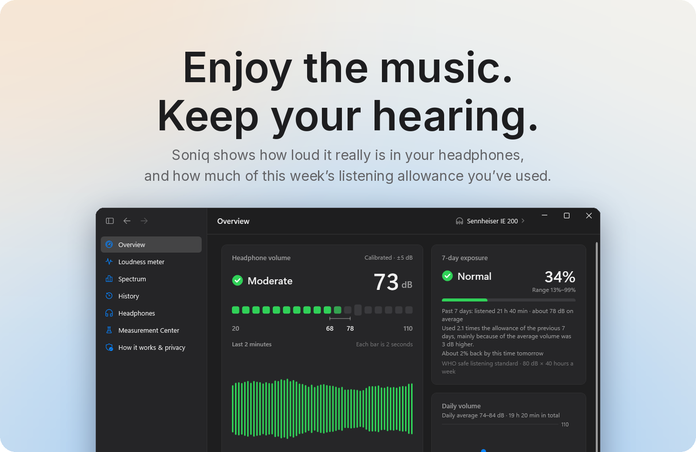
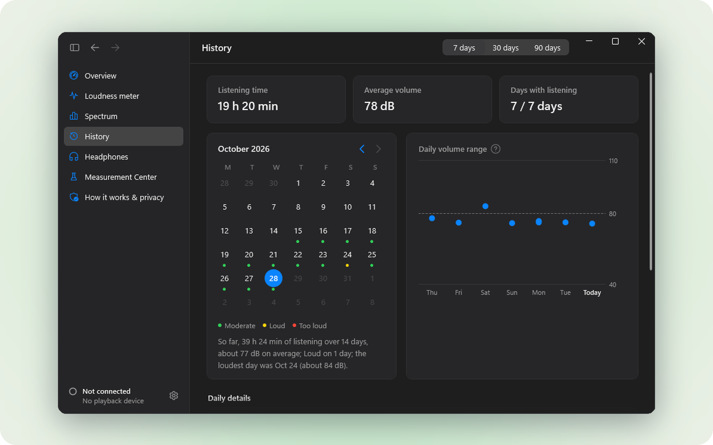
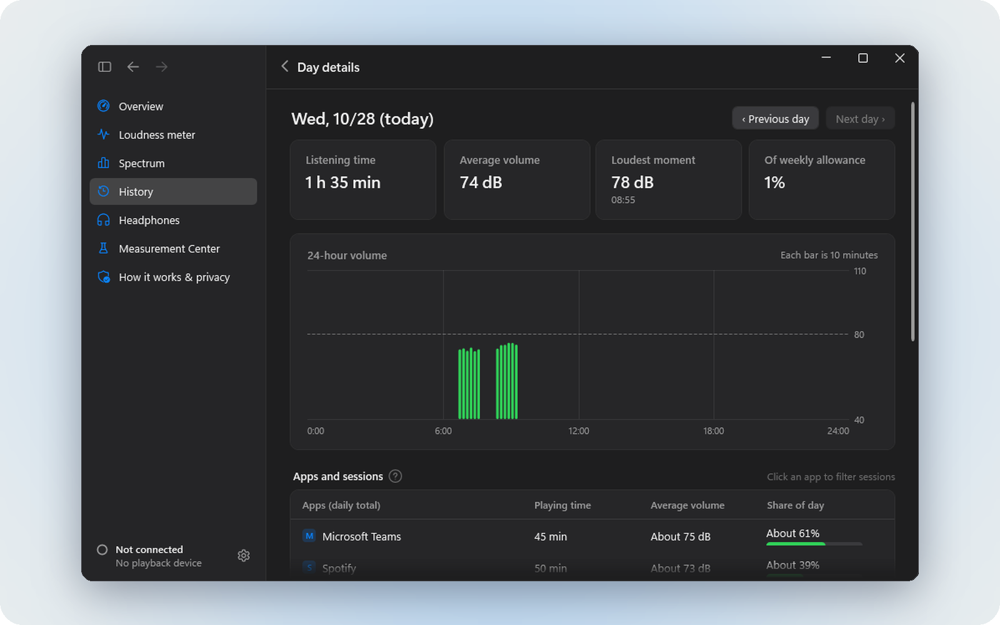
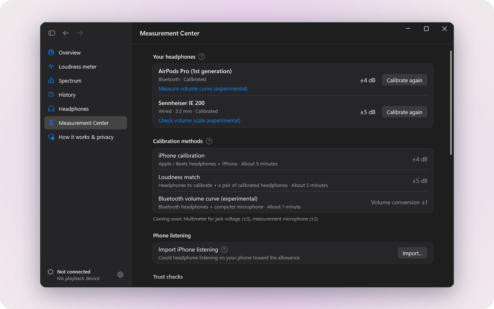
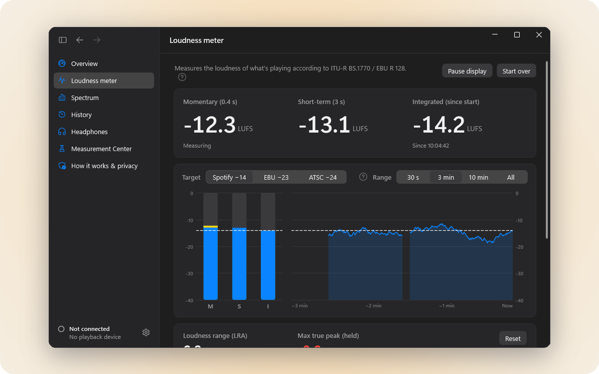
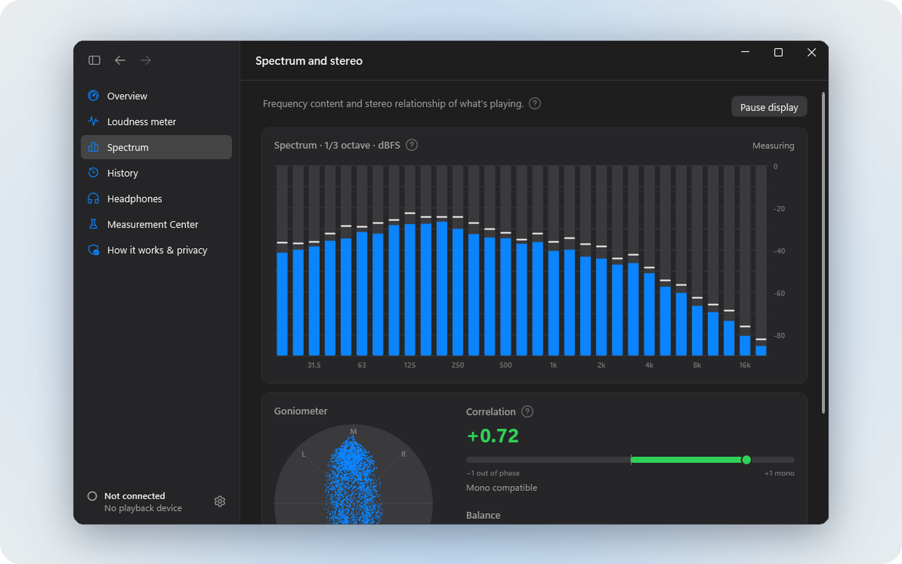

  <picture>
    <source media="(prefers-color-scheme: dark)" srcset="docs/brand/soniq-logo-dark.svg">
    
  </picture>

<b>English</b> · <a href="README.zh-CN.md">简体中文</a>

<h3 align="center"><a href="https://github.com/Keeeezy/Soniq-releases/releases/latest/download/Soniq-Setup.exe">Download Soniq for free</a></h3>

Windows 11 · English and 中文 · Public beta

  
  

 

**01 — Know how loud it really is.**
The volume slider shows a percentage. Your ears hear decibels. Soniq turns what your computer plays into the level that actually reaches your ears, and tells you honestly how sure it is.

**02 — See your week, not just this moment.**
Hearing damage adds up quietly. Soniq counts every minute against the WHO safe-listening guideline — 80 dB for 40 hours a week — so you always know how much is left.

**03 — A quiet nudge, not a nag.**
When it's been too loud for a while, Soniq lets you know. It waits while you're presenting, gaming or in Do Not Disturb, and it never records a sound.

 

## Every day, at a glance

Your listening history on a calendar, with a short summary of each month: how long you listened, how loud, and which days went over.

## Down to the session

Open any day to see when you listened, which apps the sound came from and how much of your allowance each session used. Export a session as a report with its loudness curve.

## More precise, when you want it

Soniq starts with your headphones' published specs — 260 models from 29 brands, each with its source. Want a tighter number? Calibrate AirPods with your iPhone in five minutes, or match wired headphones against a calibrated pair by ear.

## Made for people who make music

Optional tools for mixing and mastering: a loudness meter following ITU-R BS.1770 / EBU R 128 with targets like Spotify −14 LUFS, a 1/3-octave spectrum, stereo correlation and a floating meter. Off by default.

| | |
|---|---|
|  |  |

## Private by design

- **No recording.** Soniq computes sound *levels* only. It never records, stores or uploads audio.
- **Your data stays on your computer**, in `%LocalAppData%\Soniq`. No account.
- **Almost offline:** the only network access is checking this page for updates (you can turn it off) and links you open yourself, like the feedback form.

## Honest about accuracy

Soniq **estimates**; it doesn't measure inside your ear. So every number comes with a range, like “73 dB ±5”.

- **Calibrated headphones:** usually within about ±4–5 dB.
- **Wired headphones with published specs:** a wider range, mostly because laptop makers don't publish their headphone jack's output voltage.
- **Bluetooth headphones without a published maximum level:** Soniq records listening time, and shows decibels once you calibrate.

When unsure, Soniq leans to the safe side. And it's not a medical device — it doesn't replace a hearing test.

## Everything else

- **Reminders:** too loud for too long, half or all of your allowance used, time for a break, rest advice after a loud day, quiet hours.
- **Limits:** an optional volume limit, per pair of headphones if you like.
- **Health:** an ear discomfort log with advice on when to see a doctor, and a printable report for the visit.
- **Your data:** import headphone listening from Apple Health on iPhone, export to CSV, full backup and restore.
- **Hardware:** wired, Bluetooth and USB headphones, including FiiO KA1 / KA3 / KA5 and Moondrop Dawn Pro / Pro 2 adapters.
- **Feel:** light and dark mode, English and Chinese, a quiet tray icon.

Screenshots use sample data.

## Install

1. Download **[Soniq-Setup.exe](https://github.com/Keeeezy/Soniq-releases/releases/latest/download/Soniq-Setup.exe)** (about 80 MB).
2. Run it. The installer isn't code-signed yet, so Windows may show “Windows protected your PC”: click **More info → Run anyway**.
3. Choose where to install and click **Install**. Soniq starts in the notification area of the taskbar.

Soniq needs Windows 11 (64-bit); Windows 10 version 2004 or later should work but hasn't been tested. It updates itself in the background — you can turn that off in **Settings → General → Updates**. Only the latest version is available for download.

## FAQ

**Windows says the installer might be unsafe.** Soniq doesn't have a paid code-signing certificate yet, so Windows doesn't recognize the publisher. Click **More info → Run anyway**.

**My headphones don't show a decibel number.** Choose your model on the **Headphones** page. Bluetooth headphones whose maker doesn't publish a maximum level need a quick calibration in the **Measurement Center** first.

**How do I switch the language?** **Settings → General → Appearance → Language**, then restart Soniq.

**How do I uninstall?** Windows **Settings → Apps → Installed apps → Soniq → Uninstall**. Your history stays in `%LocalAppData%\Soniq` until you delete it.

**I found a bug or have an idea.** In Soniq, open **How it works & privacy → Send feedback**, [open an issue](https://github.com/Keeeezy/Soniq-releases/issues/new?template=bug.yml), or email **keezy.1147@gmail.com**. Attaching the diagnostics package (**Settings → Data & privacy**) helps a lot.

 

<h3 align="center">Ready to listen safer?</h3>

<a href="https://github.com/Keeeezy/Soniq-releases/releases/latest/download/Soniq-Setup.exe"><b>Download Soniq for free</b></a> · Windows 11

 

Soniq is free to download and use. This repository hosts the installer and update files; the source code isn't public.
