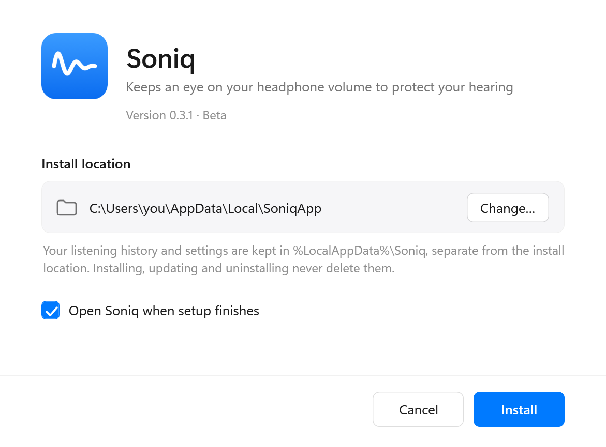

# Soniq

**English** · [简体中文](README.zh-CN.md)

Soniq is a small Windows app that looks after your hearing while you listen on headphones. It recognizes your headphones, estimates how loud the sound in your ears really is (in decibels), adds up how long and how loud you listen against hearing-health guidelines, and gives you a quiet heads-up before it becomes a problem. Everything is calculated on your own computer — nothing is recorded and nothing is uploaded.

> **Public beta.** Soniq works and is used daily, but it has only been verified on one laptop and two pairs of headphones so far. Your feedback helps a lot — see [Feedback](#feedback). The app's interface is currently in Simplified Chinese; an English interface is on the way.

## Download

1. Open [**Releases**](https://github.com/Keeeezy/Soniq-releases/releases/latest) and download **`Soniq-Setup.exe`** (about 80 MB).
2. Run it. The installer isn't digitally signed yet, so Windows may show a blue "Windows protected your PC" screen: click **More info** → **Run anyway**.
3. Choose where to install (or keep the default) and click **Install (安装)**. Soniq starts in the notification area at the bottom right of the taskbar.

**Requirements:** Windows 11, 64-bit. Windows 10 (version 2004 or later) should work but hasn't been tested yet.

## What Soniq does

**Knows how loud it really is**
- Reads the level of the sound your computer sends to the headphones (it never records it), combines it with the Windows volume and your headphones' published specifications, and converts it into A-weighted decibels — the unit hearing guidelines use.
- Built-in data for **260 headphone models** from 29 brands, with sources. Wired models use the manufacturer's sensitivity figures; Bluetooth models are recognized automatically.
- Every number comes with an honest range (for example "±5 dB"). When there isn't enough data, Soniq says so instead of guessing.

**Keeps track of your listening**
- A listening allowance based on the **WHO / ITU-T H.870** safe-listening standard (80 dB × 40 hours per week); the stricter **NIOSH** standard is optional.
- History with a calendar, daily details, listening sessions, and which apps the sound came from.
- Quiet reminders when it has been too loud for a while, when you've used a large part of your weekly allowance, or when it's time for a break. Reminders wait while Do Not Disturb or a full-screen app is on.
- Optional volume cap per pair of headphones.

**Makes it more accurate, if you want**
- **Measurement Center**: calibrate AirPods with an iPhone's built-in headphone level meter (about ±4 dB), calibrate wired headphones against already-calibrated ones by ear (about ±5 dB), or measure a Bluetooth volume curve with the laptop microphone (experimental).
- Self-tests that check the measurement chain, and a blind test that checks Soniq's predictions against an iPhone reading.

**Tools for people who make music** (optional, off by default)
- Loudness meter following ITU-R BS.1770 / EBU R 128 (momentary, short-term, integrated LUFS, loudness range, true peak), with targets such as Spotify −14 LUFS.
- 1/3-octave spectrum, stereo correlation and goniometer, and a small floating meter.

**Also**
- A diary for ear discomfort (ringing, muffled hearing) with advice on when to see a doctor, and a printable report for the visit.
- Import headphone listening from Apple Health on iPhone, export to CSV, full backup and restore.
- Light and dark mode, follows your Windows settings.

| History | Sessions and apps |
|---|---|
|  |  |

## How accurate is it?

Soniq **estimates**, it doesn't measure inside your ear. How close the estimate is depends on how much is known about your headphones and computer:

- **Calibrated** headphones: typically within about ±4–5 dB.
- **Wired headphones with published sensitivity**, uncalibrated: a wider range, mostly because laptops don't publish how much voltage their headphone jack delivers.
- **Bluetooth headphones** whose maker doesn't publish a maximum level: Soniq records listening time but doesn't show a decibel number until you calibrate.

When unsure, Soniq leans towards the safe side. The point isn't a perfect decibel reading but knowing roughly how much of your hearing allowance you're using, and acting in time.

**Soniq is not a medical device** and can't replace a hearing test.

## Privacy

- Soniq only computes sound **levels**. It doesn't record, store or upload any audio.
- All data stays on your computer, in `%LocalAppData%\Soniq`. No account is needed.
- The only network access is checking this page for new versions (can be turned off), plus anything you start yourself, like opening the feedback form.

## Updates

The installed version checks for new versions automatically (about every 12 hours), downloads them in the background, and installs them the next time Soniq starts. You can also check manually, update right away, or turn automatic checks off in **Settings (设置) → General (通用) → Updates (更新)**.

## Feedback

Found a problem or have a suggestion? In Soniq, open **How it works & privacy (工作原理与隐私)** and scroll to **Feedback (反馈问题)**, or:

- open an issue here: [New issue](https://github.com/Keeeezy/Soniq-releases/issues/new?template=bug.yml) (public)
- or email **keezy.1147@gmail.com**

Attaching the diagnostics file (Settings → Data → Diagnostics) helps a lot. It contains logs and settings, no audio. Chinese or English is fine.

## Uninstall

Open Windows **Settings → Apps → Installed apps**, find Soniq, and click **Uninstall**. This also removes Soniq from startup. Your listening history stays in `%LocalAppData%\Soniq` and is not deleted; you can delete that folder yourself if you no longer need it.

## Questions

**Windows says the installer might be unsafe.** Soniq doesn't have a paid code-signing certificate yet, so Windows doesn't recognize the publisher. Click **More info → Run anyway**.

**Soniq doesn't show a decibel number for my headphones.** Pick your model under **Headphones (耳机)**. If it's a Bluetooth model whose maker doesn't publish its maximum level, Soniq can only record listening time until it's calibrated in the Measurement Center.

**I use the portable version (Soniq.exe).** Quit it from the notification area first, then install. Your history and settings are kept.

---

This repository only hosts the installer and update files.
