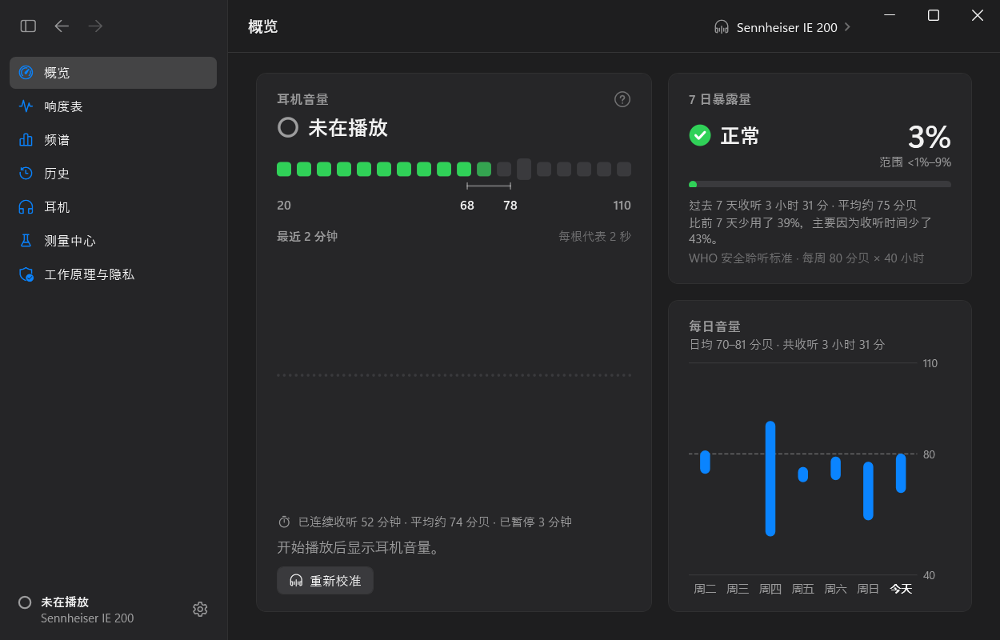
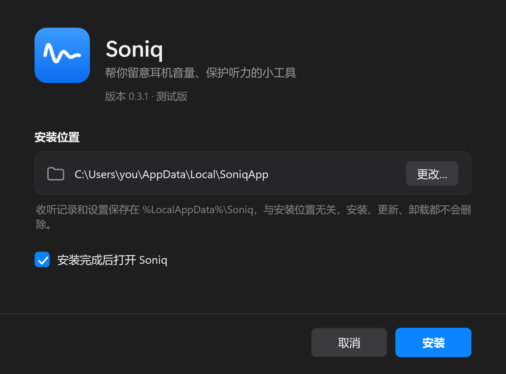
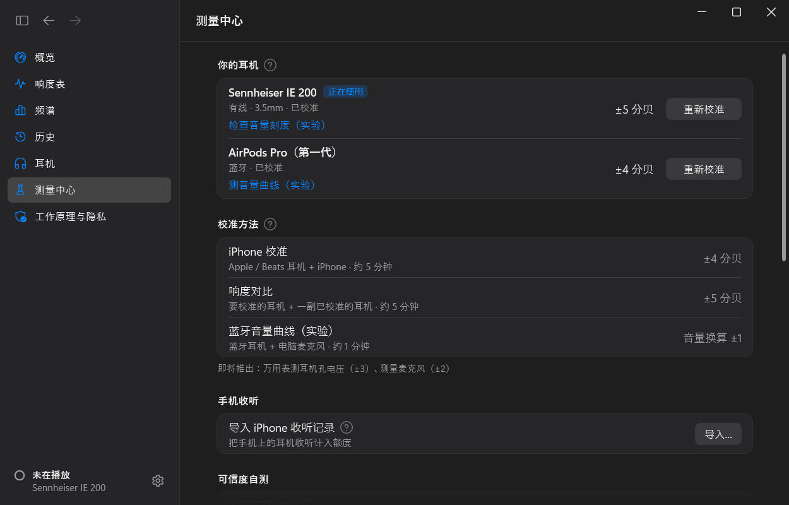
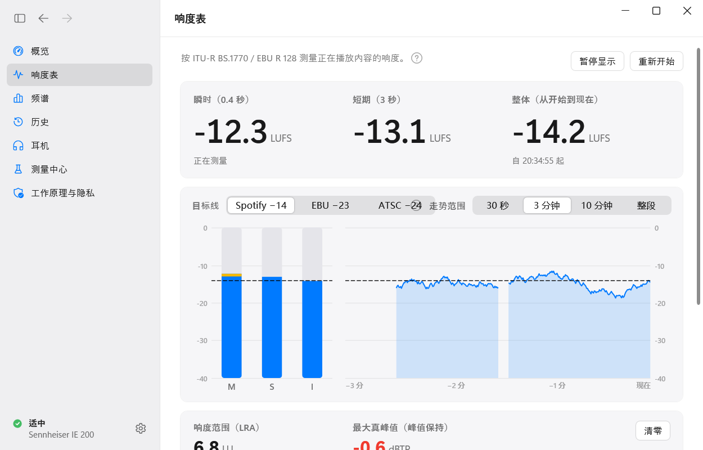
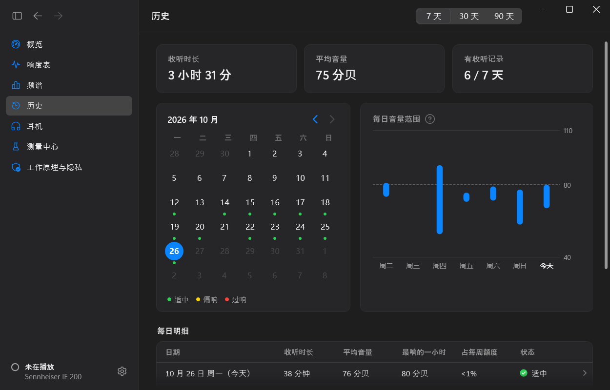
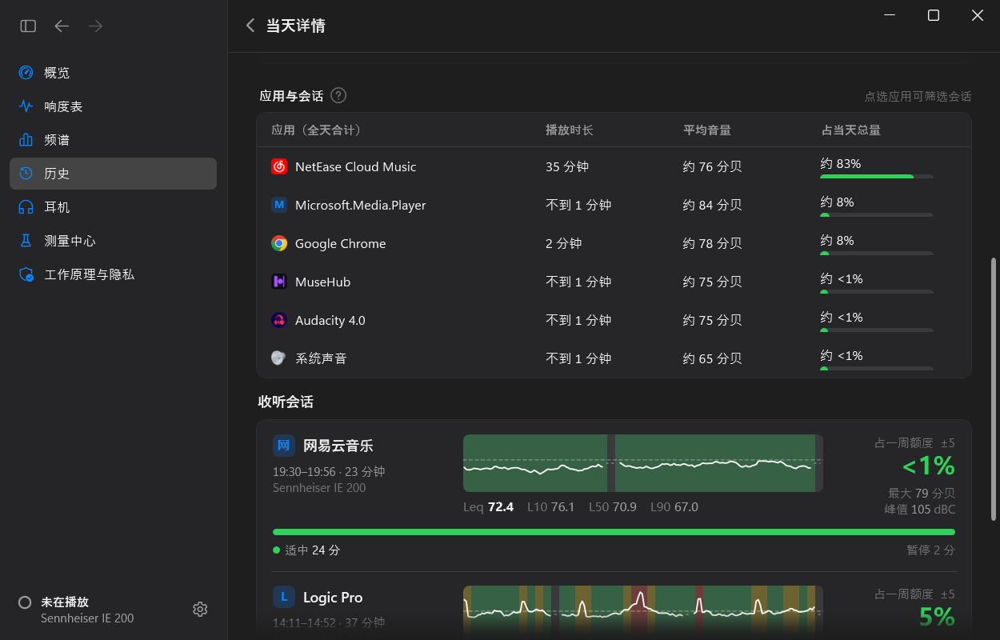

# Soniq

[English](README.md) · **简体中文**

Soniq 是一个 Windows 小工具，在你戴耳机听东西时帮你照看听力：自动识别耳机，估算耳朵里实际听到的声音有多大（分贝），按听力健康标准累计你听了多久、多响，在出问题之前安静地提醒你。所有计算都在你自己的电脑上完成——不录音，不上传任何数据。

> **公共测试版。** Soniq 已经可以日常使用，但目前只在一台笔记本电脑和两副耳机上验证过。你的反馈很有帮助，见[反馈问题](#反馈问题)。

## 下载安装

1. 打开 [**Releases（发布）**](https://github.com/Keeeezy/Soniq-releases/releases/latest)，下载 **`Soniq-Setup.exe`**（约 80 MB）。
2. 双击运行。安装程序还没有数字签名，Windows 可能弹出蓝色的「Windows 已保护你的电脑」：点 **更多信息** → **仍要运行**。
3. 选择安装位置（或用默认位置），点 **安装**。装好后 Soniq 会出现在任务栏右下角的通知区域。

**系统要求：** Windows 11（64 位）。Windows 10（2004 及以后版本）应该也能用，但还没有测试过。

## Soniq 能做什么

**知道实际有多响**
- 读取电脑发往耳机的声音强度（只算强度，从不录音），结合 Windows 音量和耳机的公开参数，换算成 A 计权分贝——听力标准用的单位。
- 内置 **260 款耳机型号**（29 个品牌）的数据，都注明了来源。有线耳机用厂商公布的灵敏度；蓝牙耳机自动识别。
- 每个数字都带着如实的误差范围（例如「±5 分贝」）。数据不够时，Soniq 会直说，而不是瞎猜。

**记录你的收听**
- 按 **世界卫生组织 / ITU-T H.870** 安全聆听标准计算听力额度（每周 80 分贝 × 40 小时）；也可以改用更严格的 **NIOSH** 标准。
- 历史记录：日历、每日详情、收听会话，以及声音来自哪个应用。
- 安静的提醒：持续过响、本周额度用掉一大半、该休息了。开着勿扰模式或全屏应用时，提醒会等一等再出现。
- 可以给每副耳机设分贝上限。

**想更准，可以自己测**
- **测量中心**：用 iPhone 自带的「耳机音量」读数校准 AirPods（约 ±4 分贝）；以已校准的耳机为参照、用耳朵对比校准有线耳机（约 ±5 分贝）；用笔记本麦克风测蓝牙耳机的音量曲线（实验）。
- 数字链路自检，以及用 iPhone 读数检验 Soniq 预测的盲测。

**给做音乐的人**（可选功能，默认关闭）
- 响度表，按 ITU-R BS.1770 / EBU R 128（瞬时、短期、整体 LUFS，响度范围，真峰值），可以对照 Spotify −14 LUFS 等目标。
- 1/3 倍频程频谱、立体声相关度与相位仪、悬浮迷你表。

**其他**
- 耳朵不适记录（耳鸣、发闷），告诉你什么情况该去看医生，并能生成就诊时用的报告。
- 导入 iPhone「健康」里的耳机收听记录、导出 CSV、完整备份与恢复。
- 深色和浅色模式，跟随 Windows 设置。

| 历史 | 收听会话与应用 |
|---|---|
|  |  |

## 准不准？

Soniq 是**估算**，不是在耳朵里测量。估得多准，取决于对你的耳机和电脑了解多少：

- **校准过**的耳机：一般在 ±4–5 分贝以内。
- **有公开灵敏度的有线耳机**，未校准：范围更宽，主要是因为笔记本电脑不公布耳机孔的输出电压。
- 厂商不公布最大音量的**蓝牙耳机**：Soniq 只记录收听时长，校准之后才显示分贝数。

拿不准时，Soniq 会往安全的方向估。目标不是分贝数完全准确，而是让你大致知道听力额度用了多少，及时调低。

**Soniq 不是医疗设备**，不能代替听力检查。

## 隐私

- Soniq 只计算声音的**强度**，不录音、不保存、不上传任何声音。
- 所有数据都在你的电脑上（`%LocalAppData%\Soniq`），不需要账号。
- 唯一的联网是到这个页面检查新版本（可以关闭），以及你自己点开的东西，比如反馈页面。

## 更新

安装版会自动检查新版本（大约每 12 小时一次），在后台下载，下次启动 Soniq 时自动装上。也可以在 **设置 → 通用 → 更新** 里手动检查、立即更新，或关闭自动检查。

## 反馈问题

遇到问题或有建议？在 Soniq 里打开 **工作原理与隐私**，滚到最下面的 **反馈问题**，或者：

- 在这里提问题：[新建问题](https://github.com/Keeeezy/Soniq-releases/issues/new?template=bug.yml)（公开可见）
- 或发邮件到 **keezy.1147@gmail.com**

附上诊断包（设置 → 数据 → 诊断包）能更快找到原因。诊断包里有日志和设置，不含任何声音。中文或英文都可以。

## 卸载

打开 Windows **设置 → 应用 → 已安装的应用**，找到 Soniq，点 **卸载**。开机自启也会一起删除。你的收听记录保存在 `%LocalAppData%\Soniq`，不会被删除；不再需要的话可以自己删掉这个文件夹。

## 常见问题

**Windows 提示安装程序可能不安全。** Soniq 还没有购买代码签名证书，所以 Windows 认不出发布者。点 **更多信息 → 仍要运行** 即可。

**我的耳机不显示分贝数。** 在 **耳机** 页选好型号。如果是厂商不公布最大音量的蓝牙耳机，在测量中心校准之前，Soniq 只能记录收听时长。

**我在用免安装版（Soniq.exe）。** 先在通知区域右键 Soniq → 退出，再安装。收听记录和设置都会保留。

---

这个仓库只存放安装程序和更新文件。
