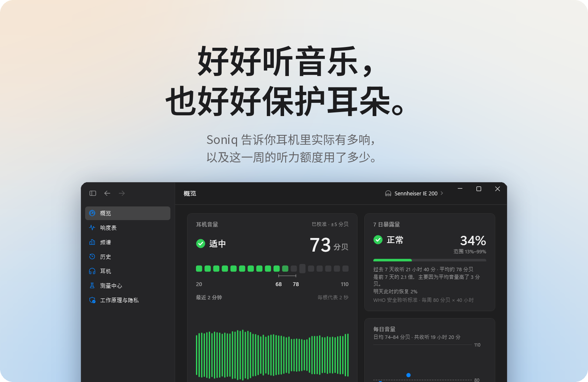
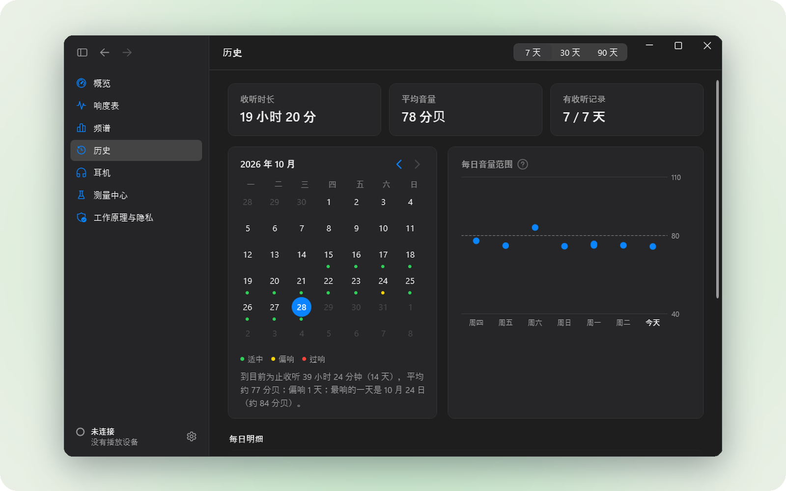
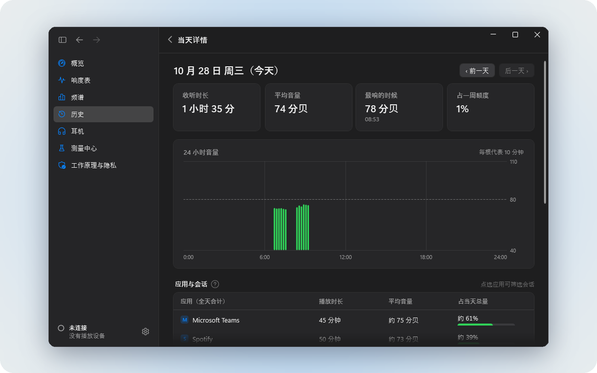
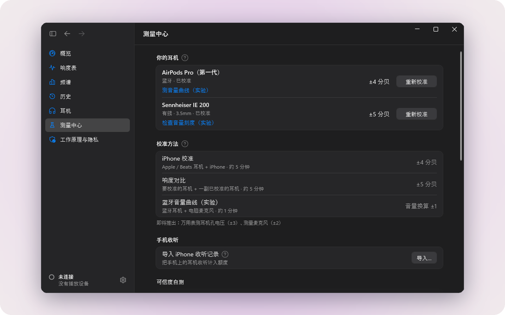
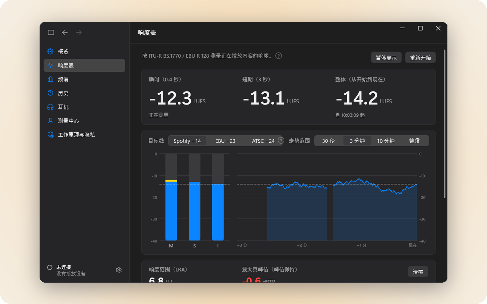
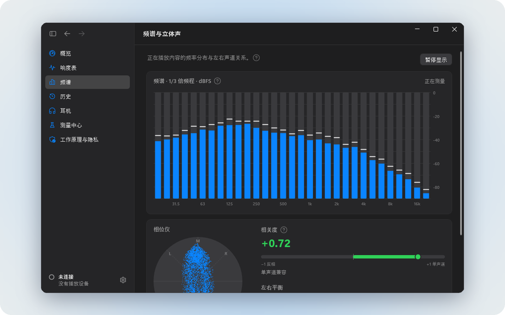

  <picture>
    <source media="(prefers-color-scheme: dark)" srcset="docs/brand/soniq-logo-dark.svg">
    
  </picture>

<a href="README.md">English</a> · <b>简体中文</b>

<h3 align="center"><a href="https://github.com/Keeeezy/Soniq-releases/releases/latest/download/Soniq-Setup.exe">免费下载 Soniq</a></h3>

Windows 11 · 中文和 English · 公共测试版

  
  

 

**01 — 知道实际有多响。**
音量滑块上显示的是百分比，耳朵听到的是分贝。Soniq 把电脑播放的声音换算成真正进到你耳朵里的音量，并且如实告诉你有多大把握。

**02 — 看一整周，而不只是这一刻。**
听力损伤是悄悄累积的。Soniq 按世界卫生组织的安全聆听标准（每周 80 分贝 × 40 小时）记下每一分钟，让你随时知道还剩多少。

**03 — 轻轻提醒，不唠叨。**
持续太响时，Soniq 会告诉你；你在演示、打游戏或开着勿扰时，它会等一等再说。它从不录下任何声音。

 

## 每一天，一眼看清

收听记录排在日历上，每个月还有一段小结：听了多久、多响，哪几天超了。

## 细到每一次收听

点开任何一天，看什么时候在听、声音来自哪些应用、每一次收听用掉了多少额度。每次会话都能导出带响度曲线的报告。

## 想更准，随时可以

Soniq 先用耳机的公开参数估算——260 款型号、29 个品牌，每一款都注明出处。想要更准的数字？用 iPhone 五分钟校准 AirPods，或者以一副已校准的耳机为参照，用耳朵对比校准有线耳机。

## 给做音乐的人

为混音和母带准备的可选工具：按 ITU-R BS.1770 / EBU R 128 的响度表，可对照 Spotify −14 LUFS 等目标；1/3 倍频程频谱、立体声相关度和悬浮迷你表。默认关闭。

| | |
|---|---|
|  |  |

## 从设计上保护隐私

- **不录音。** Soniq 只计算声音的*强度*，从不录下、保存或上传任何声音。
- **数据留在你的电脑上**（`%LocalAppData%\Soniq`），不需要账号。
- **几乎不联网：** 唯一的联网是到这个页面检查新版本（可以关闭），以及你自己点开的链接，比如反馈页面。

## 如实说明准确度

Soniq 是**估算**，不是在耳朵里测量。所以每个数字都带着范围，例如「73 分贝 ±5」。

- **校准过的耳机：** 一般在 ±4–5 分贝以内。
- **有公开参数的有线耳机：** 范围更宽，主要是因为笔记本电脑厂商不公布耳机孔的输出电压。
- **没有公布最大音量的蓝牙耳机：** Soniq 先记录收听时长，校准之后显示分贝。

拿不准时，Soniq 会往安全的方向估。它不是医疗设备，不能代替听力检查。

## 其他功能

- **提醒：** 持续过响、额度用了一半或用完、该休息了、听得偏响的日子之后的休息建议、安静时段。
- **上限：** 可以设音量上限，也可以给每副耳机单独设。
- **健康：** 耳朵不适记录，告诉你什么情况该看医生，并能生成就诊时用的报告。
- **数据：** 导入 iPhone「健康」里的耳机收听记录、导出 CSV、完整备份与恢复。
- **硬件：** 有线、蓝牙和 USB 耳机，包括 FiiO KA1 / KA3 / KA5、水月雨 Dawn Pro / Pro 2 转接头。
- **体验：** 深色和浅色模式，中文和英文，安静的托盘图标。

截图使用演示数据。

## 安装

1. 下载 **[Soniq-Setup.exe](https://github.com/Keeeezy/Soniq-releases/releases/latest/download/Soniq-Setup.exe)**（约 80 MB）。
2. 双击运行。安装程序还没有数字签名，Windows 可能提示「Windows 已保护你的电脑」：点 **更多信息 → 仍要运行**。
3. 选择安装位置，点 **安装**。装好后 Soniq 会出现在任务栏的通知区域。

需要 Windows 11（64 位）；Windows 10（2004 及以后版本）应该也能用，但还没有测试过。Soniq 会在后台自动更新，可以在 **设置 → 通用 → 更新** 里关闭。下载页只提供最新版本。

## 常见问题

**Windows 提示安装程序可能不安全。** Soniq 还没有购买代码签名证书，所以 Windows 认不出发布者。点 **更多信息 → 仍要运行** 即可。

**我的耳机不显示分贝数。** 在 **耳机** 页选好型号。厂商没有公布最大音量的蓝牙耳机，需要先在 **测量中心** 做一次校准。

**怎么切换语言？** **设置 → 通用 → 外观 → 语言**，然后重启 Soniq。

**怎么卸载？** Windows **设置 → 应用 → 已安装的应用 → Soniq → 卸载**。收听记录保留在 `%LocalAppData%\Soniq`，不需要时可以自己删掉。

**发现问题或有想法。** 在 Soniq 里打开 **工作原理与隐私 → 反馈问题**，或者[新建问题](https://github.com/Keeeezy/Soniq-releases/issues/new?template=bug.yml)，或发邮件到 **keezy.1147@gmail.com**。附上诊断包（**设置 → 数据与隐私**）能更快找到原因。

 

<h3 align="center">准备好更安心地听了吗？</h3>

<a href="https://github.com/Keeeezy/Soniq-releases/releases/latest/download/Soniq-Setup.exe"><b>免费下载 Soniq</b></a> · Windows 11

 

Soniq 可以免费下载和使用。这个仓库存放安装程序和更新文件，源代码不公开。
